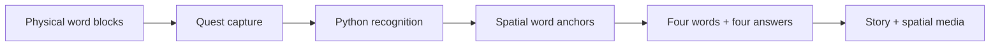

<div align="center">

# Story Bricks
### Physical words. Spatial stories.

Build words with physical blocks, capture them on Meta Quest, and turn them into an interactive AI storytelling experience.

**🏆 Best of Social Good and XR — Winner**  
**Immerse the Bay · Stanford XR**

**Unity / C# · Meta Quest / XR · Python · OCR & Braille · AI Storytelling**

[How it works](#how-it-works) · [Explore the code](#explore-the-code) · [Run the project](#run-the-project) · [Team integration](Documentation/COMPONENTS.md)

</div>

---

## From words to worlds

Story Bricks connects hands-on word building with a mixed-reality storytelling experience. Physical words become spatial anchors in Quest; guided questions and spoken answers help shape a story.

The project brings together **physical interaction, OCR and braille recognition, voice, and spatial media** in a shared Unity and Python implementation.

## How it works

1. **Build & capture** — Arrange physical word blocks, then use a same-hand double pinch in Quest. After a three-second wait, the selected camera region is captured for recognition.
2. **Recognize & anchor** — The recognition pipeline processes the cropped image and connects accepted words to spatial word boxes.
3. **Talk & imagine** — In live mode, each accepted word feeds a guided conversation. Four words and four saved answers complete a story.
4. **Experience the story** — Presentation events connect word boxes and the story stage to voice, sound, images, and supplied video.



### Two ways to play

| Mode | Experience |
| --- | --- |
| **Live story** | Shared capture and recognition, live conversation, and a story built from four accepted words and four saved answers. |
| **Prepared story** | The same capture and recognition flow with authored media; no automatic conversation API calls. |

Word boxes can be created during conversation or playback. Extra accepted words wait for the next story.

## Explore the code

| Area | What it contains |
| --- | --- |
| [Unity runtime](Assets/BrailleSoundDemo/Runtime/) | Capture, spatial word anchors, conversation, audio, and story presentation. |
| [Python backend](Python/) | OCR and braille adapters, capture receivers, speech, and API integration. |
| [Presentation bridge](Documentation/COMPONENTS.md) | UI methods and events for connecting custom UX and media. |
| [Quest tools](Tools/) | Backend setup, device connection, build, and install scripts. |
| [Recognition source](Config/recognition-source.json) | Pinned external OCR dependency. |

### Prototype status

This repository contains the shared working functions and baseline Unity scenes. Custom designer UX and final media are separate work. Local image, audio, and video bindings are supported; **automatic Orbis video generation and public video sharing are not connected**. The included Judy storyboard uses **JUDY → FOX → RAIN → TREE**.

## Run the project

**Requirements:** Unity **6000.3.28f1** with Android Build Support, Python **3.12**, Git LFS, and a compatible Meta Quest development setup.

```sh
git clone https://github.com/hyuntori2000/story-bricks.git
cd story-bricks
git lfs install
git lfs pull
python3.12 Tools/setup-team.py --backend
```

Open `Assets/Scenes/PhysicalStoryDemo.unity` in Unity. Follow the backend and device instructions below to run the baseline experience.

<details>
<summary><strong>Backend, Quest build, and team handoff instructions</strong></summary>

# Shared functions & team handoff

This repository shares the working functions. The designers build their own UX and dashboard.

| Folder | Owner / purpose |
| --- | --- |
| `Assets/BrailleSoundDemo/` | Protected Unity core: capture, word anchors, four-word conversation and media functions. |
| `Python/` | Protected backend: local OCR, speech and API integration. |
| `Assets/DesignerWorkspace/` | Designers: Unity scenes, UX prefabs, art and media. |
| `Dashboard/` | Designers: their own dashboard implementation. |
| `Design/` | Designers: storyboard and content references. |

**Do not modify recognition or Demo logic for a design task.** Read [AGENTS.md](AGENTS.md). Request shared-function changes from the project owner.

## Use the Unity functions

Use **Unity 6000.3.28f1** with Android Build Support and **Git LFS**. Run `git lfs install` and `git lfs pull` after cloning. Open `Assets/Scenes/PhysicalStoryDemo.unity`; save a designer-owned scene copy under `Assets/DesignerWorkspace/` before adding UX.

Attach **StoryFunctionBridge** to your UI and bind its public methods to your own buttons. Attach **WordMediaPresenter** to your media prefab and assign that prefab to the coordinator. Local images/audio/video work without a media dashboard. See [Component connections](Documentation/COMPONENTS.md).

Both live and prepared modes use the shared double-pinch capture, three-second wait and cropped-image OCR. Word boxes can be created during conversation/playback. Live stories use **four accepted words and four saved answers**; extra words wait for the next story. Prepared mode does not automatically call the conversation API.

## Backend setup

Install **Python 3.12**, then run:

```sh
python3.12 Tools/setup-team.py --backend
```

Copy `.env.local.example` to `.env.local` and `.env.elevenlabs.example` to `.env.elevenlabs.local` on the backend machine; supply your own authorized keys. Never commit keys. In separate terminals:

```sh
bash Tools/start-physical-story-receiver.sh
bash Tools/start-backend.sh
```

The existing capture monitor opens at **http://127.0.0.1:8769/**. Connect/build/install a Quest with:

```sh
bash Tools/connect-quest.sh YOUR_QUEST_SERIAL
bash Tools/build-physical-story.sh
bash Tools/install-physical-story.sh YOUR_QUEST_SERIAL
```

These commands build the shared baseline scene. To test your own UX scene on Quest, ask the owner to select that scene for a separate build; the baseline build script does not include designer scene copies automatically.

The scripts support `UNITY_EDITOR` and `ADB` overrides. Designers do not need API keys to edit prefabs or prepared media. The OCR source is pinned in `Config/recognition-source.json` and installed under ignored `External/LEGO_OCR`.

## Keep changes separate

Designers use `design/*` branches and only their three folders above. Preserve Unity `.meta` files. The repository includes English AI instructions, CODEOWNERS and a design-boundary check. Those are review controls; they are not a local filesystem lock. Do not merge core changes without the owner's review.

The original private-repository handoff reported that enforced branch protection was unavailable on its account plan. That historical note does not establish protection settings for this public repository. Review design pull requests before merging, and do not push design work directly to `main`.

Capture files, local keys, virtual environments, generated builds and temporary experiments are excluded from Git. Unity scenes are preserved during normal builds.

The supplied Judy reference is **JUDY → FOX → RAIN → TREE**. Actual designer UX/media files still need to be added. Automatic Orbis generation and public video sharing are not connected. Extra dashboard/UX scaffolding is intentionally not included in this simple handoff.

</details>

