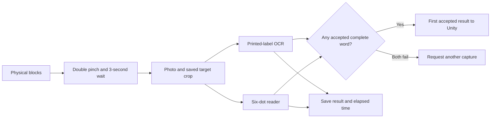
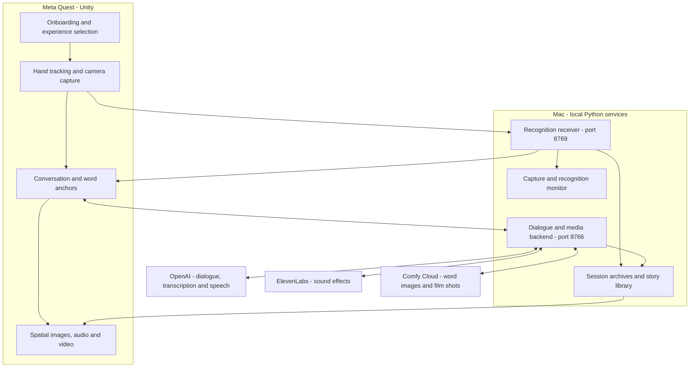

# Story Bricks

### Build a word. Give it a voice. Bring a world to life.

**Story Bricks is a mixed reality storytelling prototype that turns physical letter and braille blocks into a child's own illustrated, narrated world.** A participant arranges real blocks, captures a word with a double pinch, and answers a short spoken question. The word gains a sound and an image in the surrounding space. Their words and answers become a story, followed by a generated animated film that can be watched inside the headset and saved on a Mac.

The project explores a simple idea: **the stories children imagine should have more than one way to come into the world.** Physical construction, spoken conversation, sound, images and animation offer different ways to participate. Our design is motivated by blind and low-vision children's access to creative expression, while providing a shared visual experience for sighted participants and audiences.

This is a working research/demo prototype, not a validated accessibility or educational product. The implemented interactions, evidence and remaining limitations are described below.

> **Submission source:** [dev/demo-flow-story-library](https://github.com/hyuntori2000/story-bricks/tree/dev/demo-flow-story-library). The default `main` branch remains an earlier shared baseline. The tested application source is preserved by the [story-bricks-demo-2026-11-15 checkpoint](https://github.com/hyuntori2000/story-bricks/tree/story-bricks-demo-2026-11-15); subsequent README updates do not change that checkpoint.

## Contents

- [The experience](#the-experience)
- [What makes Story Bricks distinctive](#what-makes-story-bricks-distinctive)
- [Interaction and accessibility design](#interaction-and-accessibility-design)
- [From camera capture to a recognized word](#from-camera-capture-to-a-recognized-word)
- [From a word to a world](#from-a-word-to-a-world)
- [System architecture](#system-architecture)
- [Run the project](#run-the-project)
- [Demo walkthrough](#demo-walkthrough)
- [Storage and data handling](#storage-and-data-handling)
- [Implementation status and limitations](#implementation-status-and-limitations)
- [Team workflow and credits](#team-workflow-and-credits)

## The experience

The landing screen offers three routes with different purposes.

| Route | What the participant does | What the application does |
| --- | --- | --- |
| **Judy's Story** | Watches an authored example of the experience. | Plays the supplied 61.5-second Unity cutout story with narration, subtitles and effects, then offers replay or entry into Create Your World. |
| **Create Your World** | Builds real words and contributes spoken ideas. | Captures and recognizes blocks, guides a conversation, generates word media, narrates a story, and produces a two-scene film. |
| **See previous story** | Selects an already completed story film. | Loads the Mac's saved library and replays the selected film in VR without generating it again. |

Judy provides a consistent presentation for an audience; Create Your World demonstrates the live system with the participant's own words. These routes have separate behavior: Judy does not submit recognition requests, record answers or run the live generation pipeline. Switching into Create Your World stops the authored playback.

### A typical live session

1. The opening animation and chime introduce Story Bricks. A narrator says, **“Are you ready for the new worlds? pinch twice!”**
2. A fresh double pinch enters Create Your World without requiring the participant to point at a menu button.
3. The participant arranges a word in one aligned row, points their capture gesture over the blocks, and pinches twice. A yellow target appears. The application waits three seconds before taking the photo.
4. The saved target crop goes to the local recognition service. When a word is accepted, its letters are spoken before the question: for example, **“M, O, O, N. Moon!”**
5. The narrator asks a short question about the first word. After the narration and ready tone, the participant answers aloud.
6. The conversation invites a related second word. That word receives spelling and a brief closing, followed by the invitation to keep building or select **Create Story**. Further words start another pair; there is no automatic three- or four-word ending.
7. **Create Story** uses the accepted words and saved spoken contributions. The narrator reads the resulting story, then announces that animation will be made.
8. The completed film plays in VR, is saved on the Mac, and opens there for preview. It can later be selected through **See previous story**.

Word images and effects arrive independently during this flow. The conversation does not have to wait for every picture to finish generating.

## What makes Story Bricks distinctive

| Design choice | Why it matters | Current implementation |
| --- | --- | --- |
| **Physical construction as creative input** | The participant starts by making something tangible, rather than typing a prompt. | Real block arrangements are photographed and converted into word events. |
| **Spoken contributions shape the story** | The child's answer adds meaning beyond the recognized word alone. | Saved answers and accepted words are included in the story request. |
| **Multiple ways to perceive the same idea** | A word can be explored through touch, spelling, speech, sound and imagery. | Spoken spelling, guided dialogue, word effects, spatial image planes and film playback. |
| **Two recognition methods on the same capture** | OCR and six-dot reading can succeed under different conditions. | Concurrent readers; the first accepted complete word is used, while both outcomes are logged. |
| **Useful work continues while media is generated** | Generative media has variable latency; one slow service should not hold up every interaction. | Separate dialogue, sound, image and video jobs with scoped request identities. |
| **A visible connection between an object and its media** | The result stays associated with the place where the participant made the word. | A captured word anchor owns its image plane and sound; sound playback animates the box. |
| **An experience that produces a keepsake** | The session creates an artifact that can be revisited after the live interaction. | Session archives, completed MP4 files, Mac preview and a VR story library. |
| **Design and engineering can develop independently** | Designers can improve the presentation without rewriting recognition and dialogue. | Designer-owned Unity assets and shared component/event interfaces. |

These are implemented design properties, not claims of measured learning gains, universal recognition accuracy or proven accessibility outcomes.

## Interaction and accessibility design

Story Bricks uses hand interaction and narration as central inputs. The Quest build is configured for **Hands Only**, with both hand inputs enabled and high-frequency tracking. Controllers are not required for the application flow.

- **Gesture entry:** after the opening invitation, double pinching can enter Create Your World directly.
- **Time to clear the capture:** a three-second delay follows the capture gesture so hands can move away from the blocks.
- **Spelling before conversation:** accepted words are spelled aloud, preserving repeated letters. A trailing period is a control signal and is not spelled as part of the word.
- **Clear speaking turns:** narration finishes before microphone capture begins, and a ready tone marks when to answer.
- **More than color feedback:** the scene includes colored capture states, but also uses spoken guidance and audio cues.
- **Independent story controls:** **Home** sits high on the right, while **Create Story** keeps its position high on the left. Both use a single pinch; Home has a slightly larger invisible target.

**Home** clears the active words and immediately shows the landing choices, preserving archived media. The existing spoken invitation can finish while the menu is visible. **Create Story** starts the story from saved progress and continues into animation; it does not end the experience. Unfinished speech is not included if the button is pressed before an answer is saved.

A recognized `.` is a separate conversational ending. It waits for the current answer and preceding queued words, asks one final question, and saves that spoken answer before creating the story. It does not act as Home. A period before any word cannot produce an empty story.

The current prototype still requires help with headset setup, permissions, block alignment and recovery from system tracking loss. The visually positioned Home and Create Story controls are also a remaining accessibility consideration. Evaluation with intended users is needed before claiming independent use.

## From camera capture to a recognized word

### Capture the intended region

The capture gesture fixes a target over the tabletop. The target is yellow before capture and blue after the photo is acknowledged. Two seconds later, the outline becomes invisible. The image plane and word anchor can remain at that location.

Recognition uses the **saved target crop**, rather than the entire passthrough view. The system retains the original photo, valid crop and metadata for diagnosis, including unsuccessful recognition attempts. The current test arrangement is **one aligned row with printed label ends facing the participant**; touching blocks are allowed, but reliable segmentation is still required.

### Run OCR and braille reading concurrently

The local Python receiver uses the pinned [LEGO_OCR](https://github.com/wogur110/LEGO_OCR) source recorded in [Config/recognition-source.json](Config/recognition-source.json).



The first complete accepted result is returned to Unity. A fast failure waits for the other reader; a later success never replaces an already selected word. This is a **first-success experiment**, not a consensus vote, so disagreement is retained for review.

The primary upstream OCR and braille readers remain intact. The integration adds a bounded English OCR retry only after the primary OCR path rejects the word. Where faces are known, the retry must cover the faces in order and agree with already accepted characters. OCR confidence remains at **0.85** for every character and line. There is no dictionary-based correction that forces a likely word such as FOX.

The application accepts English letters and period markers. A period adapter can propose a region from a confidently aligned label row and pass the original pixels to the upstream period detector; it does not invent a dot from an empty crop.

### Make failures inspectable

The capture monitor at **http://127.0.0.1:8769/** shows capture information and a plain recognition-history table: selected reader, both outputs, failure reasons, elapsed times and disagreement. The slower reader still finishes and is recorded. History persists across receiver restarts.

These timings measure recognition processing, not end-to-end capture latency: the three-second timer and network upload are excluded. Captured samples support debugging; they do not establish a general recognition-accuracy percentage.

## From a word to a world

### Dialogue and narration

The live flow uses OpenAI-backed text, transcription and speech services through the Mac backend. Short word pairs keep the demonstration manageable while allowing more words to be added. Questions and final story content use actual saved contributions rather than the designer prototype's simulated answers.

The final story is requested as **seven English sentences**. That is the intended output contract; generated language still requires review. A separate announcement precedes narration, and animation starts only after story narration finishes.

### Sounds attached to words

ElevenLabs generates an effect from the recognized word, independently of the dialogue. Concrete sound sources receive concrete descriptions: a cat meowing or a few acoustic piano notes. People and quiet objects without an inherent sound request a brief, quiet non-vocal hum rather than invented speech or activity.

Effects play as soon as they are ready at **70% of the previous effect gain**, with narration volume unchanged. The word box wobbles during playback. Bounded leveling improves weak audible output without deliberately boosting quiet-subject hums. Provider output quality can still vary.

### Images at the captured location

The supplied Comfy Cloud card workflow creates a PNG for each recognized word other than a standalone period. Unity displays it on a plane inclined **65°** from the tabletop. The placeholder plane is transparent; the generated image preserves its own aspect ratio and alpha channel.

When an image is displayed, the application requests one replay of that word's existing sound. It waits for a still-preparing or currently playing effect, rather than making another sound-generation request.

### A two-scene animated film

After narration and the animation invitation, the Mac validates the requested story against its saved successful story output. The seven sentences are divided chronologically into **two scenes**, covering sentences 1–4 and 5–7.

The supplied Comfy workflow uses **Seedance 2.5 Draft**, 480p, 16:9, with each shot lasting 6–10 seconds. It uses the story's saved word-card images as references; at least one usable card is required. Both shots are submitted before waiting, then polled concurrently. Actual rendering concurrency depends on the provider.

The backend combines the completed shots into an H.264/AAC MP4. The Quest downloads the movie before playing it, while the Mac saves the final file and opens a QuickTime preview. **Two minutes is a generation target, not a guaranteed completion time.** The two-scene film is a short visualization of the narrated story, not a two-minute movie.

Completed films remain in the story library. Replaying a saved film does not submit new recognition or generation requests. Public upload/share links are not implemented; the saved MP4 is available for manual sharing.

## System architecture



Camera processing and recognition run on the Mac. Generative services are accessed by the backend; provider keys are not embedded in the APK. The default development connection uses USB and `adb reverse` to reach the local services.

Requests carry workspace, experience, conversation, capture-group and request identities. This keeps late results associated with the experience that created them. Image and video jobs use bounded queues and persisted identities. Retrying an owned local request reuses the job; an ambiguous paid upstream submission is not silently resubmitted.

The main interfaces are `/word-image`, `/story-video` and `/story-library`, with owned result paths for completed images and movies. See [runtime and implementation notes](Documentation/DEVELOPMENT_NOTES.md) and [Comfy workflow documentation](Python/workflows/comfy/README.md) for detailed behavior.

## Run the project

### Requirements

| Component | Requirement |
| --- | --- |
| Headset | A compatible Meta Quest with passthrough camera access and hand tracking; the current device test used Quest 3S. |
| Unity | **6000.3.28f1**, Android Build Support, SDK/NDK and OpenJDK. |
| Backend | Mac with **Python 3.12**, Git, Git LFS and an internet connection for generation. |
| Connection | USB debugging enabled and authorized on the headset. |
| Services | Authorized OpenAI, ElevenLabs Sound Effects and Comfy Cloud access, with sufficient provider credits and workflow/model availability. |
| Physical setup | Suitable letter/braille blocks, a stable tabletop, adequate lighting and one aligned word row. |

The full live demo depends on the Mac services. Editing designer prefabs and prepared Judy media does not require live generation keys.

### 1. Clone the current implementation

```sh
git clone --branch dev/demo-flow-story-library https://github.com/hyuntori2000/story-bricks.git
cd story-bricks
git lfs install
git lfs pull
```

For the fixed application source checkpoint, use the `story-bricks-demo-2026-11-15` tag in a clean checkout. Create a development branch before making changes.

### 2. Install the backend dependencies

```sh
python3.12 Tools/setup-team.py --backend
```

This installs the pinned recognition source under `External/LEGO_OCR`, its OCR environment and the separate voice/media environment. The video requirements include `imageio-ffmpeg`; a compatible system ffmpeg can also be used.

### 3. Configure local credentials

On a fresh clone, copy the templates and fill in your own authorized credentials:

```sh
cp .env.local.example .env.local
cp .env.elevenlabs.example .env.elevenlabs.local
cp .env.comfy.example .env.comfy.local
```

Do not overwrite an existing configured environment. These local files are ignored by Git.

| File | Purpose |
| --- | --- |
| `.env.local` | `OPENAI_API_KEY`, text/transcription/speech model settings and narrator voice. |
| `.env.elevenlabs.local` | `ELEVENLABS_API_KEY` and Sound Effects model; the supplied default is `eleven_text_to_sound_v3`. |
| `.env.comfy.local` | `COMFY_API_KEY` and the Comfy Cloud base URL. |

Use the committed templates as the configuration reference. Changing local settings requires restarting the backend. Do not put credentials in Unity assets, workflow exports or GitHub.

### 4. Start the services

In separate terminals, from the repository root:

```sh
bash Tools/start-physical-story-receiver.sh
```

```sh
bash Tools/start-backend.sh
```

Open **http://127.0.0.1:8769/** for the capture monitor. The voice and media backend runs on port **8766**. Keep both services running during the live demo.

### 5. Build and install

```sh
bash Tools/connect-quest.sh YOUR_QUEST_SERIAL
bash Tools/build-experiences.sh
bash Tools/install-physical-story.sh YOUR_QUEST_SERIAL
```

The Unity scene is `Assets/Scenes/PhysicalStoryDemo.unity`. The main Android package is **`org.braillelab.storydemo`**; the output APK is `Builds/Quest/WordsToWorldsPhysical.apk` (a retained internal filename). The separate `com.storybricks.parentui` package is the original UX prototype, not the live integrated app.

The scripts accept `UNITY_EDITOR` and `ADB` overrides. Normal builds preserve the shared XR rig and existing scene. Wear and unlock the headset, accept required system permissions, and confirm hand tracking before beginning.

## Demo walkthrough

A reviewer can explore the project in two stages:

1. Select **Judy's Story** to see the authored presentation and its visual language.
2. Select **Create Your World**, or use the spoken double-pinch entry after onboarding.
3. Build one aligned word, capture it, and observe its spelling, question, sound and image.
4. Answer after the ready tone, then build a related second word.
5. Select **Create Story** after the answer is saved. Listen to the story and the animation announcement.
6. Wait for actual video completion. Watch it in VR and check the saved Mac preview.
7. Return to the landing screen and use **See previous story** to replay an archived film.

The audience can follow recognition results in the Mac capture monitor. Failed captures are retained for analysis; a failed recognition should prompt another capture rather than silently substituting a word.

## Storage and data handling

Each experience owns its saved artifacts. **Home resets the live experience, not the archive.**

| Location | Contents |
| --- | --- |
| `runtime/workspaces/create-world/sessions/<experience-id>/` | Session state, requests/results, audio, accepted contributions and story outputs. |
| `.../images/` | Word-image job records and completed PNGs. |
| `.../videos/<job-id>/` | Film job records, shot files and final `story.mp4`. |
| `runtime/workspaces/story-library/index.json` | Index of completed films available for VR replay. |
| `runtime/physical-story-captures/` | Default receiver capture archive and recognition history. |
| Configured `capturedimage2026` archive | Original photos, valid target crops and metadata under the configured mode/session hierarchy. |
| Quest `ExperienceSessions/` | Local session snapshots, generated speech and story exports. |

Recognition failures are saved too. A durable Quest outbox can synchronize session snapshots after connection interruptions, but force-killing the app does not restore its previous live scene on restart.

Local recognition does not make the entire experience offline: cloud generation sends the required text, recorded speech or reference images to the configured providers. Raw microphone recordings are transient in the application flow; transcripts, generated audio and story records can remain in the session archive. This prototype does not claim a complete child-data consent or retention-management system. API keys, captures, generated media, builds and local environments are excluded from the source repository.

## Implementation status and limitations

The repository contains working integrations and device-tested flows, with several important boundaries for reviewers.

| Area | Evidence or current boundary |
| --- | --- |
| Build and install | The current application checkpoint built and installed successfully on Quest. |
| Single-pinch story control | Focused input verification passed; a real device log recorded Create Story selection followed by story generation. Home still needs direct confirmation in the final test. |
| Recognition | OCR/braille dispatch and the bounded English retry have focused offline coverage and real capture examples. No representative accuracy benchmark has been completed. White/mixed blocks, boundaries, pose and lighting remain important test cases. |
| Image generation | A recent FOX image completed and was saved on the Mac; a subsequent COAT image was displayed in VR. |
| Tracking recovery | A tracking-origin reset cancels image delivery and hides old spatial anchors. An already generated image is not automatically reattached after recovery. This caused the recent missing FOX image in VR and remains unresolved. |
| Story language | The intended output is seven English sentences, but the latest recorded output contained a stray non-English/self-correction fragment. Generated prose still needs review. |
| Hand tracking | The app enables both hand inputs, but cannot override Quest system sleep, lock state, permissions or loss of tracking. |
| Generated films | Two-scene generation, local saving and playback are implemented. Render time and visual consistency depend on external services; two minutes is a target. |
| Accessibility | Gesture and audio-first interaction choices are implemented. Independent use and benefit for blind/low-vision children have not yet been validated. |
| Sharing | Saved movies and VR replay are implemented. Orbis integration and public video-sharing links are not connected. |

For maintainers, focused offline checks include:

```sh
Python/.ocr-venv/bin/python -m unittest discover -s Python -p test_parallel_recognition.py
PYTHONPATH=Python Python/.venv/bin/python -m unittest test_comfy_word_images test_comfy_story_videos
```

The Comfy tests use fake providers rather than paid generation. Passing these checks is not a substitute for headset interaction testing. Resolve or explicitly accept the remaining demo limitations before promoting this branch to `main`.

## Team workflow and credits

| Area | Ownership |
| --- | --- |
| `Assets/BrailleSoundDemo/` | Shared Unity capture, recognition integration, word anchors, conversation and media behavior. |
| `Python/`, `Config/`, `Tools/` | Backend, pinned dependencies, service integration and setup/build tooling. |
| `Assets/DesignerWorkspace/` | Designer-owned scenes, presentation prefabs, graphics and prepared media. |
| `Dashboard/`, `Design/` | Designer dashboard work, content and storyboard references. |

Designers connect UI through **StoryFunctionBridge** and attach media through **WordMediaPresenter** and presentation events. This allows presentation changes without editing core recognition or demo behavior. See [component connections](Documentation/COMPONENTS.md), [designer presentation setup](Assets/DesignerWorkspace/StoryBricks/README.md) and [AGENTS.md](AGENTS.md) for ownership and AI-assistant instructions.

Owner development uses `dev/*`; designer work uses `design/*`. Preserve Unity `.meta` files and review changes before merging. These instructions and checks are collaboration controls, not a filesystem lock. Current work is pushed to `dev/demo-flow-story-library`; `main` is not updated automatically.

Story Bricks combines the team's Unity UX, Judy cutout story and Comfy workflows with the pinned **wogur110/LEGO_OCR** recognition source, Meta Quest hand/passthrough capabilities, OpenAI services and ElevenLabs effects. Bundled models and third-party assets retain their own notices; see [OCR model provenance](Python/models/README.md) and the associated asset/license files. Provider names describe integrations, not endorsement.

Detailed runtime behavior, archive layout, earlier rollback branches and integration notes are preserved in [Development and runtime notes](Documentation/DEVELOPMENT_NOTES.md).
